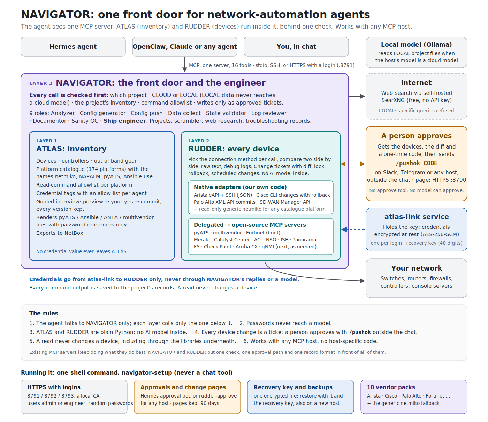

# NAVIGATOR

An independent MCP server for network-automation agents. It works with any MCP host (Hermes, OpenClaw, Claude,
or your own agent): the agent gets one server, NAVIGATOR, that is its front door to inventories, credentials and
devices. Inside it run three layers, and NAVIGATOR checks every call (project, mode, inventory, allowlist) before
it reaches the layer below.

| Layer | Component | Package | Status |
|---|---|---|---|
| 3 | **NAVIGATOR: engineer and front door** (projects, CLOUD / LOCAL, 9 roles incl. SHIP_ENGINEER, QC, lessons, scrambler, research, troubleshooting) | `navigator_engineer` | **built (P7a, P7b, P7d)**, host setup in `navigator-setup` |
| 2 | **RUDDER: every device**: reads (any connection method, side by side, debug), changes approved out of band, scheduler | `rudder_devices` | **reads (P3, P5 delegated, P6 vManage), Arista (P4), Cisco and PAN-OS changes (P6), scheduled changes (P7b)** |
| 1 | **ATLAS: inventory, platform catalogue, encrypted credentials, interview, render, NetBox export** | `atlas_inventory` | **built (D1, P1, P2, render P7d)** |

Services beside it: `atlas-link` (holds the key, decrypts one credential per connection) and `rudder-scheduler`.
`atlas-mcp` and `rudder-mcp` still run on their own for users who want only one layer; the default install is
the single `navigator-mcp`.



## Documentation

Start with these five. Every other document is listed in **docs/README.md**, the one index.

1. [docs/THREE_LAYERS.md](docs/THREE_LAYERS.md): what the three layers are, in one page.
2. [docs/INTEGRATION.md](docs/INTEGRATION.md): connect a host (Hermes, OpenClaw, Claude Code, Cursor, your own…).
3. [docs/INTERVIEW.md](docs/INTERVIEW.md): first-time setup with `navigator-setup`, and changing it later.
4. [docs/HOW_TO_USE.md](docs/HOW_TO_USE.md): daily use on any host; projects; the CLOUD / LOCAL chat model.
5. [docs/CHEATSHEET.md](docs/CHEATSHEET.md): what to say in chat and which tool it calls.

design/, decisions/ and labs/ hold the plans as written, every decision, and the test labs.

**Models:** NAVIGATOR has no model of its own. The host's chat model is CLOUD or LOCAL (on Hermes per
thread: `/model cloud`, `/model local`). LOCAL project data never goes to a cloud model; a local model
reads it through `local_model` ([docs/LOCAL_MODELS.md](docs/LOCAL_MODELS.md)).

## NAVIGATOR tools (16; each takes an `action`)

No model inside: the host agent does the thinking. Everything ships in the package (roles, scrambler,
templates); `EXTRA_SKILLS` in `navigator.yml` only adds your own.

| Tool | Actions | What it does |
|---|---|---|
| `inventory` | list, show, query, validate, history, platforms, platform, commands, template, **render**, netbox_export | ATLAS reads; `render` writes pyATS / Ansible / ANTA / multivendor files with credential references only |
| `inventory_edit` | start, answer, status, preview, commit, cancel, list | the interview: draft → preview → the user's yes → commit |
| `credential` | list, test | tags (never values); login test, optionally `via=` one connection method |
| `device` | read, facts, **compare** | allowlisted reads; `via=` (eapi, ssh, netmiko, pyats, multivendor, fortinet, vmanage) for one call, `raw=true`, `debug=true` (connection log, secrets removed); compare = the same reads through two or more methods with a diff |
| `adapter` | list, **default** | which adapter serves what; store a connection method as a default (an interview, versioned) |
| `change` | propose, schedule, status, apply, cancel, list | change tickets, approved only with `/pushok` on the approval channel; scheduled changes |
| `troubleshoot` | start, note, stop, show | a recorded session: every read in it goes to `RECORDS/TROUBLESHOOT/` |
| `project` | create, show, list, status, close, task | project folders under WORKSPACE (TASK.md, RUNLOG.md, NAVIGATOR_STATE.json, LOGS/ CONFIG/ OUT/ RECORDS/ RAW/) |
| `mode` | get, set | CLOUD or LOCAL. To LOCAL at once; to CLOUD only after `/pushok` |
| `role` | list, brief | the 9 roles (ANALYZER, CONFIG_GENERATOR, CONFIG_PUSHER, DATA_COLLECTOR, STATE_VALIDATOR, LOG_REVIEWER, DOCUMENTOR, SANITY_AGENT, **SHIP_ENGINEER**): a full brief for a subagent |
| `qc` | check, record | SANITY_AGENT's 8-point checklist and verdict in the run log |
| `lesson` | add, list | lessons learned, append-only; LOCAL projects must be generic |
| `skill` | list, load | shipped skills plus your own folders |
| `scrambler` | sanitize, text, restore, map | the scrambler (below) |
| `research` | (query, fetch) | web search through the local SearXNG; LOCAL: generic queries only; always logged ([docs/SEARXNG.md](docs/SEARXNG.md)) |
| `local_model` | status, ask | a local OpenAI-compatible model (Ollama…) reads project files; LOCAL on a cloud host: the answer stays in `OUT/` ([docs/LOCAL_MODELS.md](docs/LOCAL_MODELS.md)) |

**The front-door check** on every inventory, device, change and credential call: the project and its MODE (a
project with an inventory works only on it; a LOCAL project's data never reaches a cloud model; records go to `<project>/RECORDS/DEVICES/` and a RUNLOG line),
the consumer's inventories and tags (ATLAS), the platform's command allowlist (in a lab inventory
`LAB_ANY_SHOW` can allow any plain `show …`), and writes only as tickets with `/pushok`.

The per-layer tables below describe the same functions as the standalone `atlas-mcp` / `rudder-mcp` tools.

**Scrambler modes:**
- **default:** secrets only (passwords, type-7, enable secrets, TACACS/RADIUS keys, SNMP communities and v3 keys, routing auth keys, PSKs, hashes, certificates). Nothing else changes.
- **deep:** default plus public IPs, public BGP ASNs, hostnames, domains, users, descriptions, serials, MACs and denylist terms, mapped per project and restorable. `level: strict` also maps object, ACL, VRF and policy names.

Every run is leak-checked; a failed run is written to `SANITIZED/<ts>-<mode>-FAILED`, and `sanitize_text` then returns no text. Maps are kept privately in `~/.navigator/scrambler/<project>/map.json` (mode 600).

```bash
navigator-mcp                                  # stdio; settings in navigator.yml (or NAVIGATOR_BOOTSTRAP)
navigator-skills export ~/.hermes/skills/navigator   # roles + scrambler as SKILL.md folders for a host
```

## ATLAS tools (read-only; no tool ever returns a credential value)

| Tool | What it does |
|---|---|
| `inventory_list` | inventories with device / controller / OOB counts and credential tags |
| `inventory_show` | one line per record, with filters (names, groups, FIELD=value, record_type) |
| `inventory_query` | chosen fields as structured data, plus PLATFORM, READS, WRITES, PRODUCTION |
| `inventory_validate` | required fields, duplicates, secret-looking keys, catalogue checks, optional TCP probe |
| `platform_list` / `platform_show` | the platform catalogue: names per tool and which RUDDER adapter serves it |
| `command_list` | the read command allowlist per platform and category |
| `credential_list` | tags, type, fields set or missing, encrypted or plain, which inventories use them |
| `interview_start` / `_answer` / `_status` / `_preview` / `_commit` / `_cancel` / `_list` | guided changes: draft → preview → the user's yes → commit with the preview's code |
| `inventory_history` | earlier versions of an inventory (restore with the `inventory_restore` topic) |
| `netbox_export` | push an inventory to NetBox: dry run first, then commit with its code |

## Making changes: the interview

Nothing is written until you have seen a preview and said yes. Every commit keeps the previous
version of each file and adds a line to `~/.atlas/audit.log`. Hand-written inventories keep
their formatting: an added device appends only its own lines, and an edit changes only the edited keys.

| Topic | Does |
|---|---|
| `inventory_new` | a new, empty inventory with default SITE / FAB / PRODUCTION |
| `record_add` / `record_edit` / `record_remove` | one device, controller or OOB record (`--type`). Remove = disable |
| `bulk_import` | many records from YAML or CSV, checked row by row |
| `bulk_edit` | set FIELD=value on every record that matches (e.g. MATCH `PLATFORM=EOS`, SET `CREDENTIAL=LAB_EOS`); one version per file |
| `inventory_restore` | go back to an earlier version (as a new version) |
| `credential_new` / `credential_update` / `credential_remove` | credential tags. Remove = disable, refused while in use |
| `consumer_access` | who may use which inventories and tags. **Host only**: an agent cannot widen its own access |

In a shell on the host (interactive; secrets are asked with getpass and encrypted at once):

```bash
atlas-interview run inventory_new
atlas-interview run record_add --inventory LAB2
atlas-interview run credential_new
atlas-interview run consumer_access --consumer LAB_BOT
atlas-interview list                       # open drafts (kept 7 days)
atlas-interview history LAB2               # versions
```

From an agent: `interview_start` → ask the user the returned questions → `interview_answer` →
`interview_preview` → show it → on the user's yes `interview_commit(draft, code)`.
**Passwords and keys are never asked in chat.** The agent tells the user to run
`atlas-interview secret <draft> LOGIN_PASSWORD` on the host. Storing a credential needs the vault key
(`atlas-vault init`, then back the key up; see MIGRATION.md).

Not yet: hard deletes (they need the `/pushok` approver, P4), one-time secret links (P4), and the
`setup` topic (NAVIGATOR, P7).

## NetBox export

```yaml
# bootstrap.yml
NETBOX:
  URL: https://netbox.example.net
  TOKEN_CREDENTIAL: NETBOX_API      # an API_TOKEN credential made with credential_new
  VERIFY_TLS: true
```

`netbox_export(name)` lists what it would create or update (sites, manufacturers, device types,
roles, platforms, devices, a `mgmt0` interface and the management IP as primary IP), with a code.
`netbox_export(name, code)` applies exactly that plan. It only updates devices it created (tag
`atlas`) and never deletes. Enabled DEVICE records only for now.

Inventory files (`INVENTORY_<NAME>.yml` in DATA_PATH) hold `INVENTORY:` (devices), `CONTROLLERS:` and `OOB:` lists.

## RUDDER P6: Cisco and PAN-OS changes, Viptela reads

| Platform | Lines | Dry run | Apply / rollback |
|---|---|---|---|
| Cisco IOS / IOS-XE / NX-OS (SSH) | as in `show running-config`, children indented | computed from the running config (`+` / `-` / `~`) | checkpoint (`bootflash:rudder-<ticket>.cfg`, NX-OS `checkpoint`), lines, verify; `configure replace` / `rollback running-config checkpoint`. No timer: the ticket keeps the manual rollback command |
| PAN-OS (SSH + XML API) | `set` / `delete` only | lines into the candidate, `show config running` vs `candidate`, then reverted | saved `rudder-<ticket>.xml`, API commit job, verify; rollback = load that file + commit. Refused if the firewall has uncommitted changes |
| Viptela (SD-WAN Manager API) | reads only | – | – |

`rudder.yml`: `API_VERIFY_TLS` (vManage, PAN-OS API), `COMMIT_WAIT` (seconds for a PAN-OS commit). One ticket holds one kind of device. IOS-XR changes are not built yet.

## RUDDER delegated adapters (P5): existing MCP servers behind the same front door

For platforms an existing open-source MCP server already serves well, RUDDER is an **MCP client** of that
server. Each call:
1. starts the server as a child process;
2. writes that server's inventory or testbed into a private temp folder (references only, no passwords);
3. passes the credential from ATLAS **only in the child's environment**, which is otherwise minimal;
4. calls the tool, then stops the server and removes the folder.

The command allowlist still applies first, and results come back in RUDDER's normal record format.

| Server | Used for | Tool | Notes |
|---|---|---|---|
| pyATS (upstream pyATS MCP) | Cisco IOS / IOS-XE / NX-OS / IOS-XR / ASA reads | `pyats_run_show_command` | Genie-parsed JSON where a parser exists. HTTP-only upstream: bound to 127.0.0.1 on a free port for one call, then stopped |
| multivendor-cli-mcp | SR Linux, SR OS, VyOS, RouterOS, SONiC, OS10, EXOS, VRP, EdgeOS, Cumulus, FRR reads | `run_command` | stdio; read-only (writes not enabled) |
| fortinet-mcp | FortiGate reads | `fgt_system_status`, `fgt_list_interfaces`, `fgt_get_routes`, `fgt_vpn_tunnels`, `fgt_get_policies` | API_TOKEN credential; the "commands" in COMMANDS.yml are these tool names |

```bash
scripts/install_delegated.sh            # ~/.rudder/delegated: src/ (pinned server sources), pyATS_MCP, one venv each
                                        # SERVERS_REPO / SERVERS_REF / PYATS_MCP_REPO choose where they come from
```

Writes through these servers (multivendor `apply_config`, FortiManager install) will go through RUDDER's change
tickets and `/pushok`. They are not enabled yet.

## RUDDER changes (P4): propose → /pushok out of band → apply

The whole change path, its safety checks and what is planned: [docs/RUDDER.md](docs/RUDDER.md).

| Tool | What it does |
|---|---|
| `change_propose` | check lines (deny list), refuse PRODUCTION, lock devices, save the baseline, dry-run diff on the device, send the approval request (code only to the human's Telegram) |
| `change_status` | waiting_approval / approved / applied / failed / rejected / expired / cancelled, diff per device, next step |
| `change_apply` | only after `/pushok`: drift check → commit with the switch's rollback timer → verify → confirm, or roll back |
| `change_cancel` / `change_list` | release locks and void the approval / recent tickets |
| `change_schedule` (and `change_propose(at=...)`) | apply at a set time: approved in advance, 30 s notice with a stop code, applied by `rudder-scheduler` ([docs/SCHEDULER.md](docs/SCHEDULER.md)) |

There is **no approve tool**. With the Hermes approval channel, `hermes -p <approver profile> send` delivers
the request to a separate bot, and the `push-approve` plugin turns `/pushok CODE` into a decision file.
RUDDER keeps only hashes of the code, and an approval works once.
Settings are in `rudder.yml` (`APPROVAL`, `COMMIT_TIMER`, `ALLOW_PRODUCTION`, `DENY_LINES`).

Arista over eAPI uses configuration sessions:
1. **Dry run:** a session, its diff, then abort.
2. **Apply:** `commit timer`, so the switch rolls back by itself if RUDDER dies.
3. **Verify:** the same lines must now change nothing, and the optional verify commands must match.
4. **Finish:** `configure session … commit` to keep it, or `… abort` to roll back.

## RUDDER tools (layer 2, reads)

| Tool | What it does |
|---|---|
| `device_read` | run allowlisted commands (a category or exact commands) on devices chosen from an ATLAS inventory; every output saved to `~/.rudder/records/<run>/` (mode 600). `via=`, `raw=`, `debug=` as in NAVIGATOR's `device` |
| `device_compare` | the same reads on one device through two or more connection methods, with timing, errors and a diff |
| `credential_test` | connect and run `show version`: ok / auth_failed / unreachable / timeout / tls_error / host_key (`via=`, `debug=`) |
| `device_facts` | hostname, model, version, serial, MAC, uptime (Arista EOS) |
| `adapter_list` | which adapter serves each platform and what works in this build |

Adapters in P3:
- **Arista EOS over eAPI**: JSON, with text for commands that have no JSON form.
- **Arista EOS over SSH** with `| json`, so the output matches eAPI.
- **Generic netmiko text reads** for any platform with a command list, for example PAN-OS over SSH.

Platforms served by a delegated MCP server report "P5"; vManage reports "P6".

RUDDER never reads ATLAS's files. It asks ATLAS over the **ATLAS link**, a Unix socket (mode 600) with a token per client:

```bash
atlas-link token RUDDER        # once: creates ~/.config/rudder/atlas-link.token (mode 600)
atlas-link serve               # keep running: install scripts/atlas-link.service (docs/ATLAS.md)
rudder-mcp                     # the RUDDER MCP server (stdio); settings in rudder.yml
```

Add `~/.config/rudder/` and `~/.rudder/` to the host's deny rules as well.

## Install

```bash
cd ~/navigator
python3 -m venv .venv
.venv/bin/pip install setuptools wheel
.venv/bin/pip install --no-build-isolation -e ".[test]"
```

Then edit `bootstrap.yml` (DATA_PATH, KEY_FILE, CONSUMER), or point `ATLAS_BOOTSTRAP` at your own copy.

**Hermes** (`~/.hermes/config.yaml` or the profile's, stdio): one entry, the front door.

```yaml
mcp_servers:
  navigator:
    command: /home/<user>/navigator/.venv/bin/navigator-mcp
    env: {NAVIGATOR_BOOTSTRAP: /home/<user>/.config/navigator/navigator.yml}
```
(`atlas-mcp` / `rudder-mcp` entries are only for hosts that want one layer on its own; an agent that has
`navigator` should not also have them, or it could skip the front-door check.)

**OpenClaw** (HTTPS): run `atlas-mcp --serve` (systemd `atlas-mcp-https`, port 8792, TLS and logins built in, [docs/HTTPS.md](docs/HTTPS.md)), and add it to `mcp.servers` in `openclaw.json` with `ATLAS_CONSUMER` set to that agent's consumer name (e.g. `LAB_BOT`).

Add the key folder (`~/.config/atlas/`), DATA_PATH and STATE_PATH (`~/.atlas/`) to the host's deny rules: agents use the tools, never the files.

### Host settings: navigator-setup

Run once after install, and again whenever something changes (host shell only, never a chat tool):

```bash
navigator-setup                     # the interview: PROJECT_ROOT, SKILLS_ROOT, approvals, retention, MODELS, HTTPS
navigator-setup show
navigator-setup set APPROVAL.WEB_BIND <host-lan-address>:8790
navigator-setup set MODELS.LOCAL_URL http://127.0.0.1:11434/v1 MODELS.LOCAL_MODEL qwen3.5:9b
```
Details: [docs/INTERVIEW.md](docs/INTERVIEW.md), [docs/APPROVALS.md](docs/APPROVALS.md), [docs/LOCAL_MODELS.md](docs/LOCAL_MODELS.md).

### Services and ports

| What | Runs as | Listens on | Open in the firewall? |
|---|---|---|---|
| `navigator-mcp` (the front door) | started by the MCP host (stdio) | nothing | no |
| `navigator-mcp` / `atlas-mcp` / `rudder-mcp` over HTTPS (optional, [docs/HTTPS.md](docs/HTTPS.md)) | systemd user services `*-mcp-https` | **TCP 8791 / 8792 / 8793**, TLS + login | yes, for the ones you use, from the clients' networks |
| `atlas-link` (credentials for RUDDER) | systemd user service | a Unix socket, `~/.atlas/link.sock` (mode 600) | no |
| `rudder-scheduler` (applies approved and scheduled changes) | systemd user service | nothing, unless change pages are on | no |
| **change pages** (read-only page per ticket, linked from the approval message) | inside `rudder-scheduler` | **TCP 8790** on the address in `APPROVAL.WEB_BIND` (one address, never 0.0.0.0) | **yes: TCP 8790 from the networks the approvers use** |
| SearXNG (web search for `research`) | Docker | 127.0.0.1:8888 | no |
| delegated pyATS MCP | started by RUDDER per call | 127.0.0.1, a free port, only during the call | no |

The change pages are served **directly by rudder-scheduler** (Python's standard HTTP server): no nginx or
other reverse proxy, nothing else to install. **HTTPS** with NAVIGATOR's local CA once `navigator-setup tls init`
has run (`APPROVAL.WEB_TLS auto`; [docs/HTTPS.md](docs/HTTPS.md)), meant for the LAN, for example with ufw:

```bash
sudo ufw allow from <lan-cidr> to any port 8790 proto tcp comment 'RUDDER change pages'
```
To reach the pages from outside later, use a VPN (the links then use its name: `navigator-setup set
APPROVAL.WEB_URL https://<vpn-name>:8790`) rather than opening the port to the internet. Without
`APPROVAL.WEB_BIND` nothing listens and the approval message carries the diff itself.

## Credentials

`atlas-vault status | init | encrypt | check | rekey`. Read `MIGRATION.md` before encrypting a real file.

## Tests

```bash
.venv/bin/python -m pytest -q             # no devices, no network
.venv/bin/python tests/smoke_stdio.py     # real DATA_PATH over stdio; prints summaries only
python scripts/gen_platforms.py --check   # with netmiko installed: is PLATFORMS.yml current?
```

## Platform catalogue

`atlas_inventory/catalog/PLATFORMS.yml` is generated from netmiko's platform list plus `platforms_overlay.yml` (hand-kept: vendor, aliases, tool names, adapters). Edit the overlay, then run `python scripts/gen_platforms.py`. `COMMANDS.yml` is the read command allowlist.

## License

Apache License 2.0. See LICENSE.
