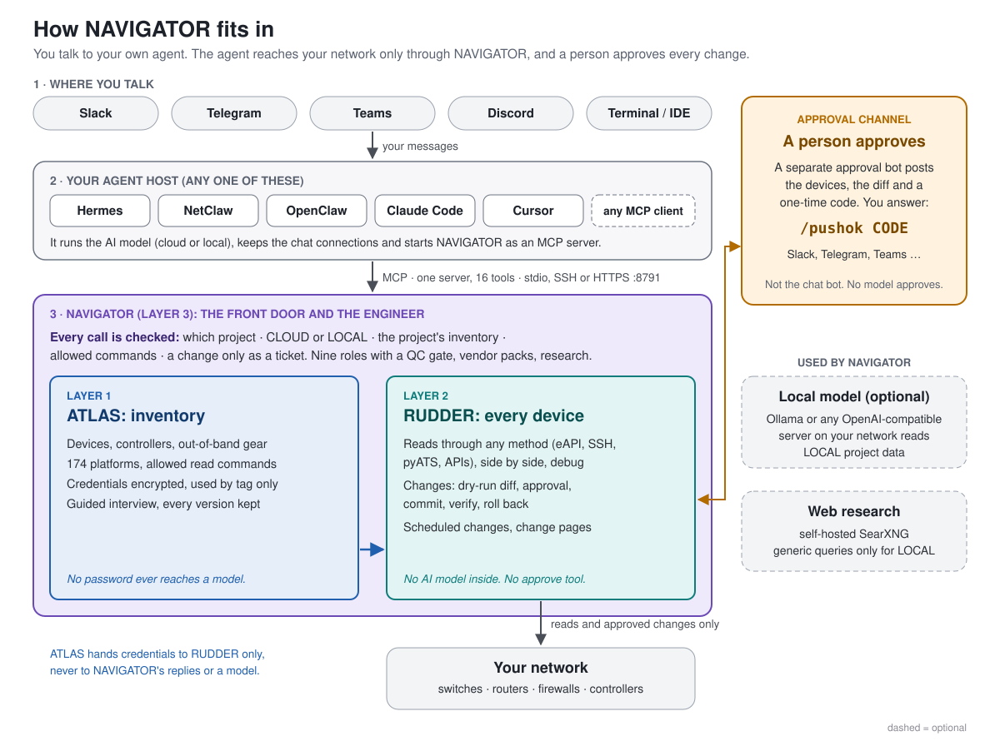

MCP server for network automation

# Let AI agents work on your network. Safely. { .nv-hero__title }

NAVIGATOR gives the AI agent you already use one front door to your inventory, your
credentials and your devices. It reads with care, and it changes nothing until a person approves.

[Get started](INTEGRATION.md){ .md-button .md-button--primary }
[How it works](INTRODUCTION.md){ .md-button }
[Try a lab](LABS.md){ .md-button }

One command: <code>curl -fsSL https://navigator.atomidea.com/install.sh | bash</code> · or <code>pip install navigator-mcp</code> · <a href="https://pypi.org/project/navigator-mcp/">PyPI</a> · <a href="https://github.com/sriatom/navigator-mcp">GitHub</a>

Works with <b>Hermes</b> · <b>NetClaw</b> · <b>OpenClaw</b> · <b>Claude Code</b> · <b>Cursor</b> · any MCP client

## Built for the way network teams work { .nv-h2 }

:material-lan:{ .nv-icon }
### Knows your network
One inventory of devices, controllers and out-of-band gear. Credentials are encrypted, and the agent only
ever sees their names.

:material-shield-search:{ .nv-icon }
### Reads with care
Only allowed show commands, through the right connection method for each device. Every output is saved
as a record.

:material-check-decagram:{ .nv-icon }
### Changes only with your approval
Every change is a ticket with a dry-run diff. A person approves it on a separate channel. Then it is
applied, verified, and rolled back if the check fails.

:material-clipboard-check-outline:{ .nv-icon }
### Validates before you approve
Optional Batfish validation models each change against the network before anyone is asked, and again
after the commit.

:material-account-group-outline:{ .nv-icon }
### A team of specialists
Nine roles do the work, from bulk collection to root cause. A QC role checks every result before you
see it.

:material-lock-outline:{ .nv-icon }
### Private data stays private
A project marked LOCAL never sends its data to a cloud model. A local model on your own network reads it
instead.

## Every change follows one path { .nv-h2 }

The agent can ask for a change. It cannot approve one, apply one early or change the rules.

<ol class="nv-steps">
<li><b>Ask</b>in plain words, in Slack, Teams, Telegram or your IDE</li>
<li><b>Propose</b>dry-run diff on the device, validation, one hash</li>
<li><b>Approve</b>a person, on a separate approval channel</li>
<li><b>Apply</b>with a rollback point on every device</li>
<li><b>Verify</b>confirm, or roll back automatically</li>
</ol>

[How RUDDER applies a change](RUDDER.md){ .nv-more }

## One front door for your agent { .nv-h2 }

Your agent runs the model. NAVIGATOR checks every call before it reaches your network.

{ .nv-figure }

Layer 3 · the front door

### NAVIGATOR
Projects, roles, the QC gate, and the checks on every call.

Layer 1 · inventory and credentials

### ATLAS
One inventory, an encrypted vault, and access per agent.

Layer 2 · the change engine

### RUDDER
The only part that reaches a device: approvals, apply, verify, roll back.

[Read the architecture](THREE_LAYERS.md){ .nv-more }

## Teach it a vendor once { .nv-h2 }

Everything about one vendor lives in one pack: platforms, read commands, connection methods
and change rules. Every role learns it at once.

AristaCiscoPalo AltoFortinetJuniperArubaF5Check PointMultivendorGeneric

[Roles and vendor packs](ROLES_AND_PACKS.md){ .nv-more }

## Start in an afternoon { .nv-h2 }

:material-download:{ .nv-icon }
### 1 · Install
One Linux host and one command (`install.sh --hermes` or `--cursor`), or the same steps one by one.

[Install guide](INTEGRATION.md)

:material-cog-outline:{ .nv-icon }
### 2 · Set up
Approval channel, services, HTTPS and the recovery key.

[Day 0 setup](DAY0.md)

:material-test-tube:{ .nv-icon }
### 3 · Try a lab
An Arista EVPN fabric or a Palo Alto firewall lab, ready for containerlab.

[Labs](LABS.md)

