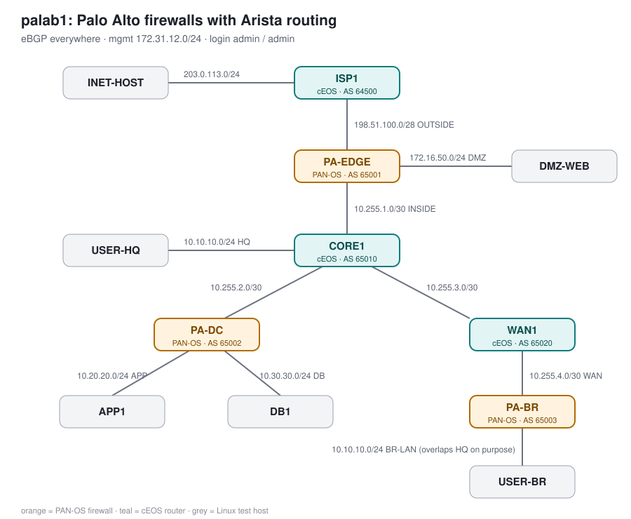

# Palo Alto Firewall Lab

Three Palo Alto firewalls with Arista routing and Linux test hosts that send real traffic: an internet edge
with NAT, a data-center firewall that segments the apps from the database, and a branch whose LAN overlaps the
headquarters LAN on purpose. eBGP everywhere.

[:material-download: Download palab1.zip](downloads/palab1.zip){ .md-button .md-button--primary }



## Start it

Build the test-host image once, then start the lab:

```bash
curl -LO https://navigator.atomidea.com/downloads/palab1.zip
unzip palab1.zip && cd palab1
docker build -t palab-host:1 host-image/
sudo containerlab deploy -t topology.yml
```

Needs Docker, containerlab, a cEOS image tagged `ceos:4338m` and the PA-VM image
`vrnetlab/paloalto_pa-vm:11.2.8` ([Labs](LABS.md#what-you-need)). Each firewall needs about 6.5 GB of RAM. The
firewalls are slow: allow **20 minutes or more** after the deploy before you can log in to them.

## What is in the zip

```
palab1/
├── topology.yml               containerlab topology, mgmt 172.31.12.0/24
├── palab1.html                lab guide (open in a browser): topology, NAT rules, flows, test questions
├── configs/                   startup configs: PAN-OS set commands and cEOS
├── templates/                 base templates for cEOS and PAN-OS
├── host-image/                Dockerfile and setup script of the Linux test hosts
├── flows.sh                   22 traffic tests (web, ping, NAT, denied flows)
├── traffic.sh                 background traffic: start, stop, status
└── pa.py                      PAN-OS helper: show commands, load set lines (needs: pip install netmiko)
```

## Nodes

| Node | Kind | Mgmt (172.31.12.x) | Role |
|---|---|---|---|
| PA-EDGE | PAN-OS | .21 | internet edge: NAT, DMZ, AS 65001 |
| PA-DC | PAN-OS | .22 | data center: APP and DB zones, AS 65002 |
| PA-BR | PAN-OS | .23 | branch with an overlapping LAN, AS 65003 |
| ISP1, CORE1, WAN1 | cEOS | .11, .12, .13 | ISP (AS 64500), campus core (65010), WAN (65020) |
| INET-HOST, DMZ-WEB, USER-HQ, APP1, DB1, USER-BR | Linux | .31–.36 | test hosts: web server, iperf3, SSH |

Login: **admin / admin** on every node, the firewalls included. A firewall that refuses the login is still
booting: give it the full 20 minutes or more.

## Check it

```bash
bash flows.sh               # 22 tests: PASS or FAIL against the design
bash traffic.sh start 60    # background traffic for 60 minutes; visible in the firewall sessions and logs
bash traffic.sh stop
```

## Try with NAVIGATOR

- *"show the security policy hit counts on PA-EDGE"*
- *"why can't USER-HQ reach DB1 on 5432?"* (STATE_VALIDATOR, LOG_REVIEWER)
- *"allow APP1 to reach DB1 on 5433 through PA-DC"* (a ticket with the PAN-OS diff, your `/pushok`, commit and verify)
