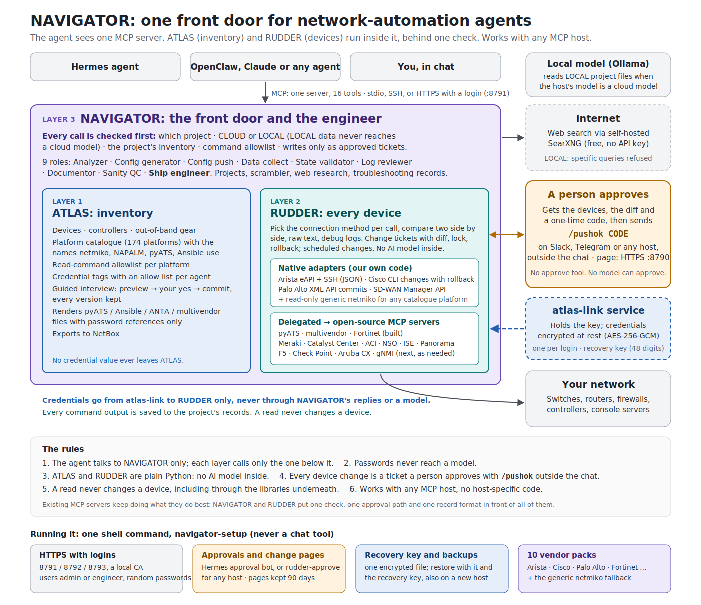
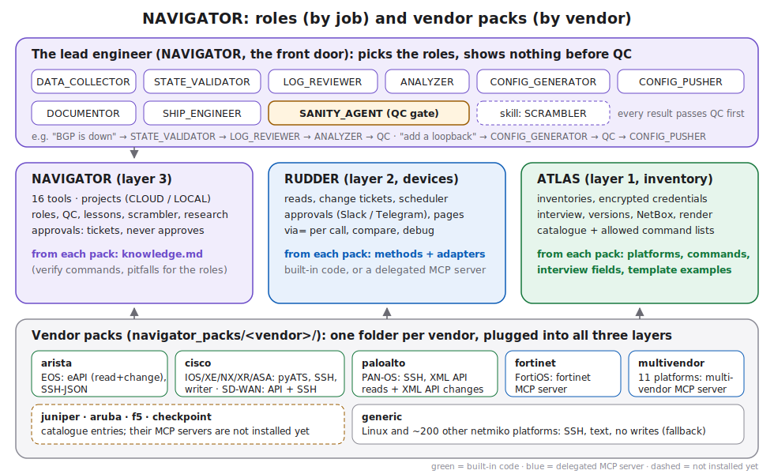

# NAVIGATOR: one front door for network-automation agents

NAVIGATOR is an independent MCP server that lets any AI agent (on Hermes, OpenClaw, Claude or your own host)
work with real network devices safely. The agent sees **one MCP server, NAVIGATOR**. Inside it run three layers, each depending only on the one below:
ATLAS knows what you own, RUDDER talks to the devices, NAVIGATOR runs the engineer's workflow and checks every
call before it reaches the layers below.

A longer version with the same content is in `navigator-architecture.html`.

## Why a front door?

Each device tool today has its own inventory format, reads its password from its own environment variable, and
has its own idea of "approval", often a field the model fills in itself. Giving an agent several such servers
side by side means every safety rule has to be repeated in every server, and one forgotten rule is a way around
all the others. NAVIGATOR puts one check in front of everything. Every call that touches an inventory, a device
or a change goes through these steps first:

1. **Which job:** the call names a project (or ad hoc work); output goes to that project's records and a line to its run log.
2. **Which mode:** a project is CLOUD or LOCAL, like the chat's model. A LOCAL project keeps its data away from cloud models and refuses specific web searches. A project with an inventory works only on it.
3. **Which inventory:** each agent has an allow list of inventories and credential tags.
4. **Which commands:** reads run only if the command is on the platform's allowlist.
5. **Writes:** only as a change ticket that a person approves outside the chat.

## Layer 1: ATLAS (inventory)

- **Records:** devices, controllers (SD-WAN Manager, Meraki, Panorama, FortiManager, ...) and out-of-band gear (console servers, BMCs).
- **Platform catalogue:** 175 platforms, each with the names netmiko, NAPALM, pyATS and Ansible use for it. Generated from the libraries, so it doesn't drift.
- **Credentials:** encrypted at rest with AES-256-GCM, referenced by tag only. The key and the decryption live in a separate service, `atlas-link`, which hands one credential to RUDDER per login.
- **Interview:** a guided interview to add, change and remove entries: preview, your yes, commit, every version kept. No password is ever typed into the chat.
- **Rendered files:** pyATS testbeds and Ansible, ANTA and multivendor inventories with `%ENV{...}` references, never the passwords.
- **NetBox:** can export everything it holds.

## Layer 2: RUDDER (devices)

- **Native adapters** where structured output or a safe commit path matters: Arista eAPI JSON (also over SSH with `| json`), Cisco CLI changes with rollback, Palo Alto XML API commits, SD-WAN Manager reads. Any other netmiko platform can be read through a generic adapter with the same allowlist.
- **Delegated adapters:** RUDDER calls **existing open-source MCP servers** (pyATS, multivendor CLI and Fortinet today; Meraki, Catalyst Center, ACI, NSO, ISE, Panorama, F5, Check Point, Aruba CX, gNMI as needed), started per call with the credential only in their environment.
- **Connection method per call:** `via=pyats` or `via=ssh` for one read, `compare` to run two side by side with timing, errors and a diff, `raw` for the device's own text, `debug` for the connection log with credentials removed.
- **Approval for every change:** a person gets the devices, the diff and a one-time code on Telegram or Slack (or any platform the host has: its own `/pushok` handler calls `rudder-approve`), and answers `/pushok CODE` there. The code is bound to the exact devices, lines and config hash. There is no approve tool a model could call. Scheduled changes are approved in advance and get a 30-second notice with a stop code.
- **One result per ticket:** RUDDER posts the result once to the approval channel and once to the chat thread; results a model types itself are removed by the host plugin. A line the device refused is never dropped silently: the request and the change page show it as `NOT in this change`.
- **Change pages and retention:** a read-only page per ticket (HTTPS on TCP 8790, the local CA); finished tickets, pages and baseline records are kept 90 days and cleaned up daily at 02:00; the audit log is never trimmed. A ticket cut off by a crash is marked `interrupted` and reported.
- **No AI model inside:** RUDDER is plain Python.

## Layer 3: NAVIGATOR (the front door and the engineer)

- **One server, 16 tools**, each with an `action`. The full table is in ../README.md (section "NAVIGATOR tools").
- **Nine roles** as briefs for subagents: Analyzer, Config generator, Config push, Data collect, State validator, Log reviewer, Documentor, Sanity QC and **Ship engineer**, who keeps the inventories and connections working and troubleshoots the automation itself.
- **Projects** are folders (not inventories), CLOUD or LOCAL, with a task file, a run log and records.
  `project action=search` finds text such as `vlan 3102` in every file of a project and returns the config
  block around each hit, with no model and no size limit on the files.
- **Scrambler:** removes secrets (or also IPs, ASNs and names) before anything goes to a public model, and puts the real names back afterwards.
- **Web research** through self-hosted SearXNG: free, no API key, every query logged.
- **Model:** NAVIGATOR has none; it uses the host agent's model. The chat model is CLOUD or LOCAL (on Hermes per thread: `/model cloud`, `/model local`; default LOCAL). For a LOCAL project on a cloud model, `local_model` lets a local OpenAI-compatible model (Ollama…) read the files (all of them by default, or only the blocks a `search=` finds) and writes its answer to the project's `OUT/`; the cloud model gets only the file name. NAVIGATOR's own setting is `MODELS.HOST` ([LOCAL_MODELS.md](LOCAL_MODELS.md)).
- **State:** plain files, no database: tickets and the audit log in RUDDER's state folder, the job's history in its project folder, lessons in one file (../design/STATE_AND_MEMORY.md).

## A real case: pyATS on an SD-WAN edge

pyATS reads of a lab Catalyst SD-WAN edge always timed out, while SSH read the same device in two seconds. One
`compare` with `debug` showed why: on a Controller-Managed IOS-XE device, pyATS's login library probes the mode,
sends `pnpa service discovery stop` to the device, waits, and logs in a second time (~25 s), and its default
login also enters config mode. RUDDER now opens pyATS sessions that never configure during a read, skips the
probe, and keeps one login per run: three commands in 8.9 s instead of a timeout on each. Any read-only tool
built on pyATS inherits that default login unless it sets these options.

## Roles and vendor packs

NAVIGATOR is organised two more ways ([ROLES_AND_PACKS.md](ROLES_AND_PACKS.md)):
- **By job: nine roles** (sub-agents) the lead hands work to: DATA_COLLECTOR, STATE_VALIDATOR, LOG_REVIEWER,
  ANALYZER, CONFIG_GENERATOR, CONFIG_PUSHER, DOCUMENTOR, SHIP_ENGINEER, and SANITY_AGENT, the QC gate every result
  passes before the user sees it.
- **By vendor: ten vendor packs** (`navigator_packs/<vendor>/`), each plugged into all three layers: platforms,
  command lists, interview fields and template examples for ATLAS; connection methods and adapters for RUDDER;
  knowledge for NAVIGATOR's roles. Built-in methods: Arista (eAPI, SSH), Cisco (pyATS, SSH, netmiko writer,
  SD-WAN Manager API and SSH), Palo Alto (SSH, XML API reads and changes). Delegated to existing MCP servers:
  Fortinet, multivendor; Juniper, Aruba, F5, Check Point once their servers are installed. Everything else:
  the generic netmiko pack. A host turns packs on or off with `NAVIGATOR_PACKS`.

## The rules

1. The agent talks to NAVIGATOR only; each layer calls only the one below it.
2. Passwords never reach a model.
3. ATLAS and RUDDER are plain Python, with no AI model inside.
4. Every device change is a ticket a person approves with `/pushok` outside the chat.
5. A read never changes a device, including through the libraries underneath.
6. Independent of any one agent host: plain MCP (stdio, or HTTPS with logins on 8791-8793), no host-specific code.

## Status

- **Built:** ATLAS (encrypted credentials, catalogue, interview, versions, NetBox export, rendering); RUDDER
  (reads, Arista / Cisco / PAN-OS changes, scheduled changes, compare and debug, approvals on Slack or Telegram,
  read-only change pages); NAVIGATOR (projects, nine roles, QC, scrambler, research, the single front door,
  `navigator-setup` with retention, `rudder-approve` for any host, `local_model`); **ten vendor packs**.
  296 tests.
- **Live:** a Slack chat bot and a tool-less approval bot (Hermes) against lab fabrics; also usable from
  Claude Code or Cursor over SSH; Ollama on the same host for LOCAL files.
- **Next:** pack interview fields wired into the interview; Cisco
  NETCONF / RESTCONF, NX-API and IOS-XR changes; encrypted
  secrets in host configs (Bitwarden is an option); pip / uv packaging.
- **Guides:** [INTEGRATION.md](INTEGRATION.md) (connect a host), [HOW_TO_USE.md](HOW_TO_USE.md),
  [INTERVIEW.md](INTERVIEW.md) (first setup), [SHIP_ENGINEER.md](SHIP_ENGINEER.md).
- **Packaging:** one `navigator-mcp` server; `atlas-mcp` (inventory) and `rudder-mcp` (devices) can also run on their own.
